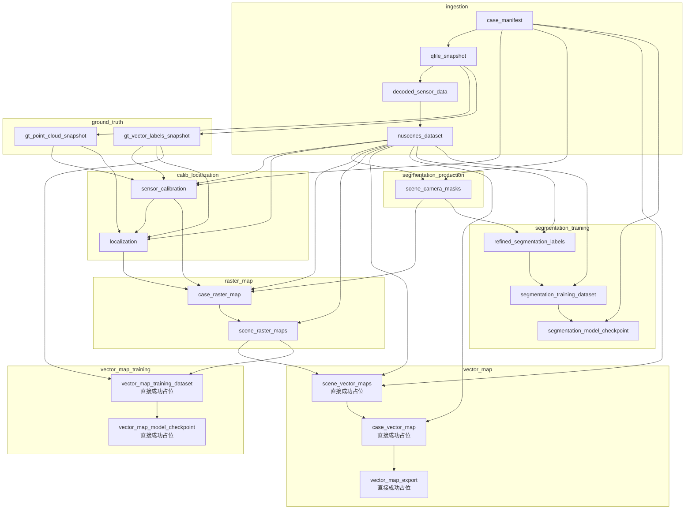

# 流水线架构

## 数据流

Case 是 Dagster 动态 partition。登记的 `case_manifest` 将 Case 身份、qfile 地址和模型配置
写入真实的 `payload/case.json`，返回统一的 `ArtifactRef`。
GT 地图来自 qfile 的录制历史。NuScenes 执行结果 metadata.scene_ids 决定 Scene 动态分支。

标定与定位两个资产独立执行、保存版本和发布成功标记。
`sensor_calibration` 与 `localization` 都依赖两个 GT 资产，
录制地图缺失、失败、歧义或下载校验失败时，GT 快照明确失败。
`module_localization_job` 选择统一的标定、定位链及全部上游。

标定输出 `calibrated_sensor.json`。定位输出 payload 根目录的
`ego_pose.json`、`lidar_undistort.json` 和 `data/<scene>/`。
两者默认 `passthrough: true`：标定将 NuScenes 原始标定记录及字段值原样保留在输出的 `records` 中，
跳过帧读取、窗口选择、LiDAR/相机求解和相机模型、backend 加载；仍校验 Case manifest、NuScenes、
两种 GT 的输入身份和目录，以及 `calibrated_sensor`、`sensor` 两表及其关联。
定位使用 NuScenes 原始 `ego_pose` 完成点云运动去畸变，保留源定位数值并跳过优化。
标定报告与两者结果的 `metadata.passthrough` 使用布尔值记录模式，metrics 同步记录。
关闭标定透传后才执行实际外参求解，选中相机时读取 manifest 中的本地模型。
Case 配置用必填 `data_engineering_resource` 作为资源根，`model_uri` 使用根内相对路径；
render 将根转为绝对路径但保留相对模型路径，登记时才展开为 manifest 中的绝对路径。
配置和登记不检查模型文件存在，不复制资源；算法实际消费时校验模型。
生产和地图训练共用标定、定位、Case 栅格地图与 Scene 裁剪结果。
标定要求 GT 输入，但尚未执行 GT 几何对齐，实际对齐状态为 false。
定位的 GT 点云配准由配置开关控制，状态按实际接受的 scene 记录。
矢量训练保留 GT 标签及公共栅格链的上游依赖。矢量生产三个入口和训练两个入口当前全部直接返回成功，
不读取或校验业务输入，不生成业务文件；算法结果的 metrics、metadata 均为空。
成功仅表示入口执行完成，公共协议、上游状态及发布检查仍然生效，不新增配置开关。
分割、标定和栅格地图的验证报告由所属算法写入自身 payload，随同一次执行返回状态。
资产图不包含报告节点。

## 名称与分组

资产名称描述产物，`case_` 表示 Case 级产物，`scene_` 表示 Scene 级处理，集合使用复数。
标定、定位和栅格地图使用统一的无后缀资产名。训练直接以模型 checkpoint 资产结束。
执行算法的 op 使用资产名称；图组合函数使用 `_graph` 后缀，发出和收集等辅助 op 使用动作名称。
Dagster key、算法登记键、协议 `asset_name` 和物理产物目录使用同一个资产名称。

`src/dagster_pipeline/defs/assets/common.py` 中的 `AssetGroup` 枚举定义
`ingestion`、`ground_truth`、`calib_localization`、`segmentation_production`、`segmentation_training`、
`raster_map`、`vector_map`、`vector_map_training` 八个分组。
栅格合成与裁剪位于 `raster_map`，矢量推理、合并和导出位于 `vector_map`，
矢量训练数据与 checkpoint 位于 `vector_map_training`。定义共 19 个资产、18 个执行规格和 6 个 job。
资产模块和 jobs 导入枚举；执行助手从当前 Dagster 资产定义读取所属分组，
再将分组传给 runner 和 ArtifactStore。算法请求只接收确定的输出 URI。

## 接口与引用构造

算法接收 `AssetRequest` 并返回 `AssetResult`，使用 `protocol_version: v1.0`。
`inputs` 类型为 `dict[str, list[ArtifactRef]]`，key 使用真实上游资产名，每个引用的
`asset_name` 必须与 key 一致。单输入列表长度为 1，场景汇总列表按 Scene ID 排序。
所有受管引用都指向 payload 目录，算法返回指标和控制元数据。
Python/C++ 通过独立 `asset_protocol` 协议层读写公共请求、结果、引用和结构化错误。
公共协议以 Draft 7 JSON Schema 为唯一字段定义，通过固定版本 quicktype 生成 Python dataclass 与 C++17 类型。
Python 使用 json/jsonschema，C++ 使用 nlohmann/json/Valijson 在读写边界严格校验；配置解析和业务检查由算法负责。
公共字段由单一 [JSON Schema](../src/protocol/schema/asset_protocol.v1.schema.json) 定义，
共享契约样例同时验收两端实现；运行时使用 Schema 校验，不运行代码生成。
算法进程只依赖算法自身工具和协议层，不导入 Dagster 或 Dagster Pipes；Dagster 的 Pipes
客户端、缓存、成功标记、失败摘要和进程诊断都留在编排层。
编排从请求和 `assets.yaml` 登记
构造引用，读取结果中的 metrics 作为执行记录，透传 metadata。

以 Localization 为例：

1. `case_manifest` 发布 `payload/case.json` 和正常的结果、成功记录。
2. `nuscenes_dataset` 资产调用转换算法，编排构造指向 payload 的 `ArtifactRef`。
3. `sensor_calibration` 接收 NuScenes、两种 GT 和 manifest。默认透传只校验输入及标定两表，将原始记录保留在输出 `records` 中。关闭透传后执行求解；启用相机时读取 manifest 中的两个本地模型，要求可读，不复制或下载模型，不计算摘要。
4. IOManager 保存和恢复 `ArtifactRef`；Scene 调度内部只传字符串 ID。
5. `localization` 组装 `nuscenes_dataset`、`sensor_calibration`、`gt_point_cloud_snapshot`、`gt_vector_labels_snapshot` 四个单引用列表。
6. Localization C++ 从 NuScenes 引用获取 dataroot 和生产者 data_version，读取普通算法 YAML；默认透传使用原始 ego pose 完成点云去畸变。
7. C++ 写入 payload 根目录的两份索引及 data；编排构造对应定位资产引用。

`AssetRequest.config_path` 指向 `<runtime_root>/build/config/algorithm/` 中已渲染的算法 YAML。
Hydra 仅负责安装前的配置合成，算法直接读取普通 YAML，按统一资产名校验上游输入。
物理算法模块与配置路径按算法职责组织。

全部资产输出使用 `ArtifactRef`，不保留 Case、Model 或 Scene 的专用传输类型。
IOManager 只恢复统一引用及内部基础 JSON 值，并处理受管 URI 的位置迁移。输入资产字典由下游资产函数组装，
不在 IOManager 中推测算法所需数据。

## 缓存与执行

执行目录为 `<root>/<case>/<group_name>/<asset_name>/<data_version>/[scene]`，业务 URI 指向其 `payload/`。
runner 根据 Case、分组、资产名、版本和 Scene 重建规范目录，不使用请求中任意指定的路径。
缓存由手工维护的 `data_version` 和明文上游版本清单决定。源数据、通道或算法配置改变时，
维护对应生产者版本并重新渲染配置。具体缓存命中、版本传播、并发锁和离线消费规则统一见
[编排缓存规则](../src/dagster_pipeline/README.md#缓存规则)。

manifest 内容不计算摘要，不拼入 `data_version`。模型路径、内容或 manifest 内的模型版本
变化本身不触发缓存失效；维护相关资产显式版本，或逐一强制重算受影响节点及下游。缓存命中时不重新读取模型文件。

成功执行由编排原子发布 `_SUCCESS.json`；失败执行写入当前目录的 `_failure.json`。
资产、op 和 job 不设置 Dagster 自动重试；失败后由 Dagster 手动重跑。错误类别固定为
`input`、`resource`、`algorithm`、`process`、`protocol`，SIGKILL 不能推断 OOM。

## 多 Scene 集合

`scene_camera_masks`、`scene_raster_maps`、`scene_vector_maps` 的动态 Scene 子步骤各自发布
`<asset>/<version>/<scene>/payload/`，独立缓存和重试。收集步骤发布同一版本目录下的
`payload/index.json`，返回 `scene_id=null` 的 `ArtifactRef`。
索引的 `artifacts` 保存按 Scene ID 排序的完整子引用，URI 相对集合 payload，形如 `../scene-A/payload`。

集合发布先核对 NuScenes 预期 Scene、子引用身份、唯一性和成功状态，记录子产物与祖先版本，
再原子写入索引、结果及成功标记。失败不能发布集合成功；重试复用已成功 Scene。
集合发布仅替换自身 payload 和状态，不删除版本目录内的 Scene 子产物。下游通过通用索引读取函数
验证集合与子产物后组装现有算法输入列表，不使用专用集合类型。

`scene_vector_maps` 的各 Scene payload 当前为空，集合 payload 仍包含上述 `index.json`。
`case_vector_map`、`vector_map_export` 和两个矢量训练资产的 payload 为空；
普通结果与成功标记照常发布，缓存及目录搬迁沿用同一引用机制。

## 文件组织与部署

NuScenes 标准表在 `payload/<NuScenes 数据版本>/`，标准 filename 相对 dataroot。
项目自有业务清单中的路径相对该清单所在目录，允许跨资产的 .. 引用。
地图块和裁剪内部文件保持局部目录约束。

IO 的受管 URI 保存为相对产物根路径，读取时基于当前配置的根恢复；
外部源数据和模型 URI 保持原值。
资产 IO 记录保存到 `<manifest_root>/<case>/<group_name>/<asset_name>.json`，分组从上游资产定义读取；
内部 op 的 IO 记录继续使用 run、step、output 等执行标识。
部署复制完整分组资产版本目录和引用目标，包含 payload、执行结果和成功标记。
明文版本记录不包含产物根的绝对路径，完整搬迁引用依赖后可跨根目录复用。
在目标环境登记 Case 后正常运行生产者即可重建 IO，不需要复制 IO 记录。

Case 地图由 `src/algorithm/raster_map/case_raster_map/` 中的 `case_raster_map` C++ 程序执行
读取、相机投影、空间落桶、精确聚合和 PNG 导出，生产和地图训练共用其结果。
Python `algorithm.raster_map.scene_raster_maps` 执行 Scene 裁剪，仅访问相交块。
Dagster 通过文件协议调用 native 程序，继续管理
资产引用、执行锁和成功标记。定位去畸变按批次有界并行，独立写出未压缩 binary PCD。
算法原理、内存预算和回访区域处理见
[地图模块说明](../src/algorithm/raster_map/case_raster_map/README.md)。

位移抽帧属于地图算法层：使用完整 Case 的优化车辆位姿，在 sample 时间确定世界 XY
位置，默认相对上一保留帧移动至少 5cm 才保留，跨 Scene 不重置。先生成一次保留列表，
强度标定、原始对照和纹理／强度／高度／语义融合共同消费；跳过帧不读取点云、图像和
mask，Scene 裁剪中心仍由完整轨迹确定。

定位保留真实 ring 与去畸变前采集距离。地图通过共享道路格联合估计传感器、ring 和
对数距离响应，默认 6 个距离节点、8 轮 Huber；80/20 空间格留出及可识别性检查决定
是否启用距离项，覆盖不足回退并报告。每个连通传感器分量独立定标，增益限制在
0.5～2.0，范围外不外推距离，不做精确入射角校正。默认每 Case 拟合，未配置硬件 ID
时按 Case 与通道隔离；跨 Case 固定表应用要求显式硬件身份。

强度融合按 ring/帧中位数、帧内 ring 等权均值和帧代表值 Huber 完成，降低点密度与
孤立高响应帧的影响。原始对照使用相同抽帧和融合规则，P90 保留点级精确统计；
其他图层保持自身聚合方式。主预览显示融合 `intensity`，默认全 Case P1/P99、gamma 0.6；
P90 诊断、原始对照及 Scene 裁剪复用基础显示尺度。默认启用
2 米局部格的 CLAHE 增强图；这些显示处理不修改原始数值层。

协议层只解析 AssetRequest/AssetResult/ArtifactRef，Dagster 负责配置路径、执行和缓存。
校正表、留出诊断、质量报告和原始对照位于地图 payload，清单记录相对路径、SHA-256
及 Case/Scene 保留帧统计。真实效果通过道路纹理与标线对比验证，拟合诊断不代替视觉验收。

## 团队职责

| 负责人 | 主要代码和配置 |
| --- | --- |
| Dagster 编排 | src/dagster_pipeline（含 config 编排配置）、config/dagster |
| 标定与定位 | src/algorithm/calib_localization、config/algorithm/calib_localization |
| segmentation | src/algorithm/segmentation、config/algorithm/segmentation |
| raster map | src/algorithm/raster_map、config/algorithm/raster_map |
| vector map / training | src/algorithm/vector_map（训练位于 training 子目录）、config/algorithm/vector_map |
| ingestion | src/algorithm/ingestion、config/algorithm/ingestion、Case 数据登记 |

新增执行资产时在 `config/dagster/assets.yaml` 登记入口、版本、配置路径，编排负责人声明资产依赖、
真实输入资产及资源池。算法负责人实现协议入口和业务检查，并自行维护 YAML。
硬件公共值分为 `config/algorithm/sensor_hardware_7v.yaml` 和 `sensor_hardware_11v.yaml`。
render 先选择布局（默认 7v，`--vehicle 11v` 选择 11v），将参考通道、LiDAR、相机作为
全部资产的默认值，资产局部参数优先。`intensity_ring_allowlist` 仅注入 `case_raster_map`，
7v 两个上方 LiDAR 保留 0～120，11v 默认全部保留。资产局部 ring 规则整块替换公共规则。
选中布局统一安装为 `build/config/algorithm/sensor_hardware.yaml`，不记忆上次选择。
语义目录位于 `semantic_common.yaml`，仅分割和 Case 地图合成配置继承；
Scene 裁剪沿用上游地图的展示色表。`whitelist.enabled: false` 由各资产 YAML 保留，当前未实现白名单，不控制执行。
安装脚本生成最终配置，
后续修改通过 `dagster-pipeline render-configs` 显式安装；启动脚本不覆盖已安装配置。
最终 `<runtime_root>/build/config/` 保留 algorithm 与 dagster 两个子树，运行、停止和重置
只读取已安装的 runtime 与 Case 配置。运行根由 `DAGSTER_PIPELINE_RUNTIME_ROOT` 指定，
默认项目根；产物根不参与定位配置。重置清理业务产物与实例数据，保留 `build/config/` 与 native 构建结果。
