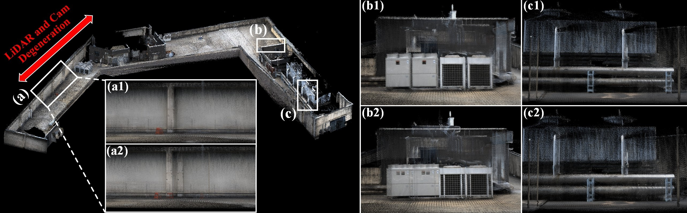
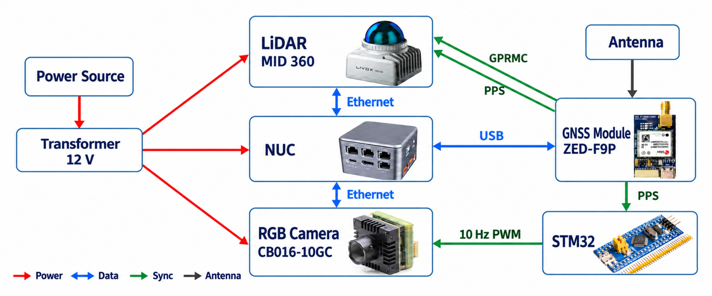
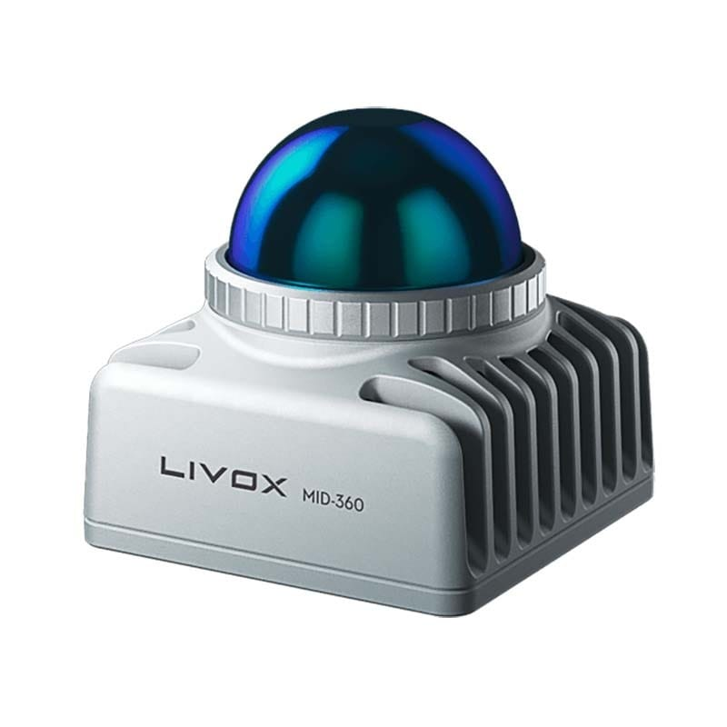
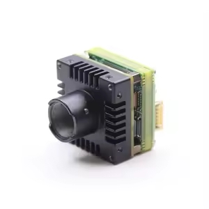
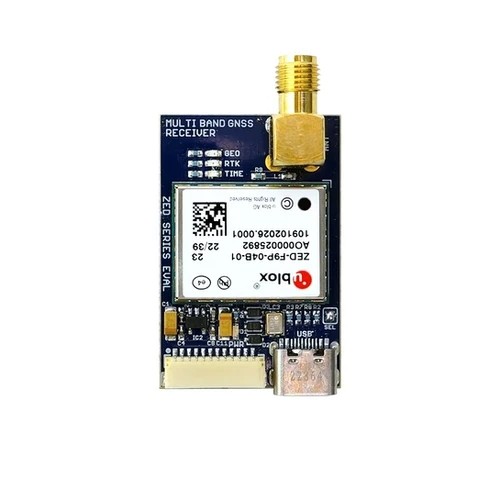
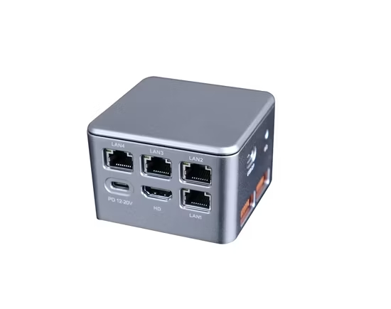
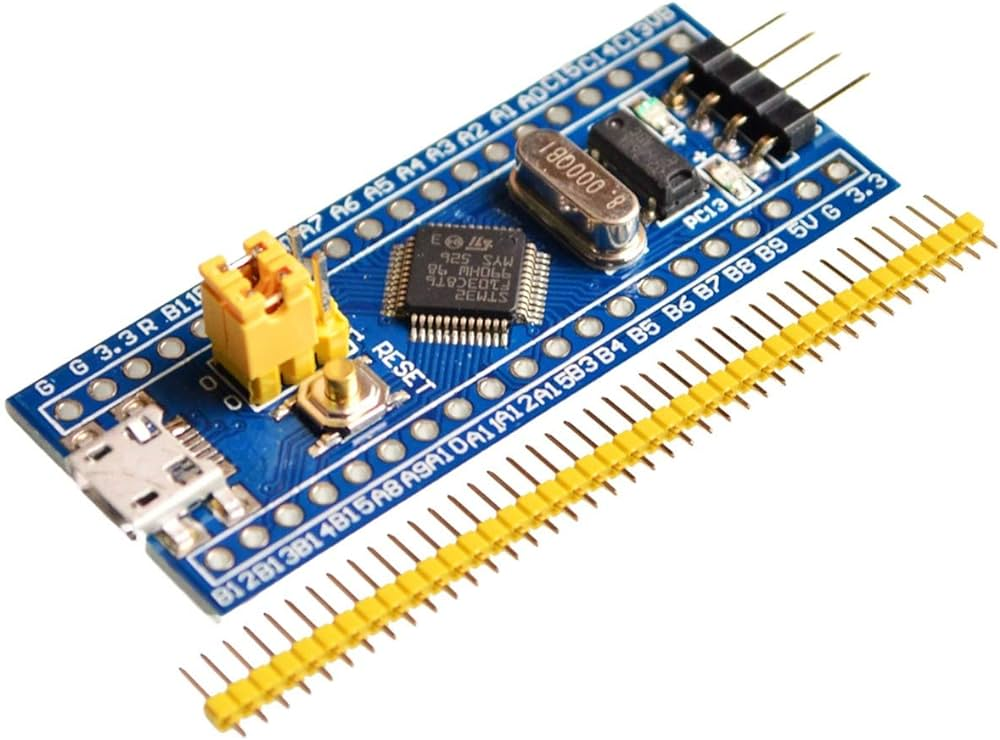

# FAST-LIVO2-RTK

FAST-LIVO2-RTK extends FAST-LIVO2 with RTK/GNSS-constrained global optimization for long-term LiDAR-visual mapping.

**Key highlights include:**

1. Fully Reproducible: Complete open-source software and hardware setup guaranteeing fully reproducible LIVO-RTK experiments.
2. Robust Initialization Module: Built-in initialization featuring cross-correlation-based time offset estimation and hand-eye extrinsic calibration.
3. LIV-RTK Fusion Paradigm: A simple example paradigm for fusing LIVO trajectories with RTK observations.

📬 For further assistance or inquiries, please feel free to contact Chunran Zheng at [zhengcr@connect.hku.hk](mailto:zhengcr@connect.hku.hk).

<div align="center">
  
  <br>
  <sub>Collected in a challenging scene with degraded geometry and texture.
<b>a2, b2, c2</b>: FAST-LIVO2 baseline. <b>a1, b1, c1</b>: results after RTK fusion.</sub>
</div>

## 1. Prerequisited

### 1.1 Ubuntu and ROS

Ubuntu 18.04~20.04. See [ROS Installation](http://wiki.ros.org/ROS/Installation).

### 1.2 PCL, Eigen, and OpenCV

PCL>=1.8, Eigen>=3.3.4, OpenCV>=4.2.

### 1.3 Sophus

Install the non-templated/double-only version of Sophus.

```bash
git clone https://github.com/strasdat/Sophus.git
cd Sophus
git checkout a621ff
mkdir build && cd build && cmake ..
make
sudo make install
```

### 1.4 Vikit

Vikit provides the camera models and math utilities required by this project. Put it in your catkin workspace source folder.

```bash
cd ~/catkin_ws/src
git clone https://github.com/xuankuzcr/rpg_vikit.git
```

### 1.5 RTK Dependencies

The RTK branch depends on the GNSS ROS message package used by the u-blox/GVINS toolchain. Put it in the same catkin workspace:

```bash
cd ~/catkin_ws/src
git clone https://github.com/HKUST-Aerial-Robotics/gnss_comm.git
```

GTSAM is used for factor graph-based post-processing optimization.

```bash
git clone https://github.com/borglab/gtsam.git
cd gtsam
mkdir build && cd build
cmake -DGTSAM_BUILD_WITH_MARCH_NATIVE=OFF -DGTSAM_USE_SYSTEM_EIGEN=ON ..
make -j$(nproc)
sudo make install
```

GeographicLib is used for converting geographic coordinates to local Cartesian coordinates.

```bash
sudo apt-get install libgeographic-dev ros-${ROS_DISTRO}-eigen-conversions
```

## 2. Run our examples

Download the provided RTK test rosbag file: [RTK-Dataset](https://drive.google.com/drive/folders/1xun-YL78cbMtyV60uN3FQFsHkkLUWvtJ?usp=sharing).

1. Launch the system and load the configuration file:

```bash
roslaunch fast_livo HH.launch
```

2. Play the rosbag. Once the sequence is finished, press `Enter` in the terminal running the launch file to trigger the backend optimizer.

```bash
rosbag play HH-LVGO-01.bag
```
## Docker 运行

本项目使用仓库统一的 [多环境入口](../../script/env/README.md)。
所有环境入口在 `script/env` 中维护，以下命令在仓库根目录执行：

```bash
./script/env/build_image.sh ros1-noetic
./script/env/prepare_deps.sh fast-livo2 ros1-noetic
./script/env/start_docker.sh fast-livo2 ros1-noetic
./script/env/build_deps.sh fast-livo2 ros1-noetic
./script/env/build.sh fast-livo2 ros1-noetic
./script/env/run.sh fast-livo2 ros1-noetic HH-LVGO-01_compressed.bag
```

容器只加载系统镜像，项目源码和仓库 `.deps` 中的第三方源码均直接挂载。
启动不编译；首次使用需依次编译第三方与项目，之后复用独立缓存。
修改项目后可在容器终端运行 `/opt/tritium/scripts/build.sh fast-livo2 ros1-noetic`，
再重启算法，不必重建镜像或重启容器。

`run.sh fast-livo2 ros1-noetic` 不带包名时只启动算法，可在另一终端执行
`./script/env/play_bag.sh fast-livo2 ros1-noetic -u 12` 单独播包。
默认数据位置为仓库 `.dataset/fast-livo2`，只读挂载；结果写入仓库 `.result/fast-livo2`。
启动时可用 `FAST_LIVO2_DATA_DIR` 和 `FAST_LIVO2_RESULT_DIR` 覆盖目录。
播包结束后在 `run.sh` 终端按 Enter 触发离线优化，Ctrl+C 仅停止算法及该次自动播包。
完全停止容器使用 `./script/env/stop_docker.sh fast-livo2 ros1-noetic`，不会删除缓存和结果。

Foxglove 桌面应用连接 `ws://localhost:8765`，导入
[布局文件](foxglove/fast_livo2_layout.json)。容器不启动 RViz，端口仅绑定宿主机回环地址。
VS Code 自动打开容器内项目，Server 缓存继续使用 `fast-livo2-vscode-server` 卷；
可将 `/deps` 添加到工作区查看第三方实现。

### 独立算法库与验收状态

完整前端、同步和 RTK 后端已抽取到 `core`，通过安装包 `fast_livo_core` 的
`fast_livo::core` 调用；ROS 1、ROS 2 只处理消息、参数、TF、发布与控制，
独立 `apps/offline/main.cpp` 使用同一库调度，不依赖 ROS。
旧 bag 的独立转换器和中立格式见 [I/O 说明](io/README.md)。

**本机 ARM64 容器的完整 HH 三入口验收已完成，默认四线程保留。**
允许不同环境使用不同数值依赖，并分别记录独立基线；没有用调整噪声参数、关闭模块、
插值或额外拟合坐标变换来通过验收。原 `src/include` 算法副本及复制的 ROS 消息头
已移除，全部算法由 `core` 唯一拥有，适配器使用真实消息 underlay。
旧源码对照归档在本地基线结果目录，不随库交付。

现代兼容配置保留 GCC 13、PCL 1.14、OpenCV 4.6、FLANN 1.9.2 和 Boost 1.83，
仅约束 Eigen 3.3.7 并一致重编相关数值依赖。历史 Eigen 3.4 组合自身重复
约 5.726 米、初版跨环境约 13.51 米的结果继续保留为未通过配置，不登记为合格基线。
正式 cpp 构建已从干净缓存复现，不能把混合不同 Eigen 头文件/库的缓存当作该候选。

已用真实 12 秒输入验证 LIVO、ONLY_LIO、ONLY_LO，以及特征预处理、
重力对齐、曝光关闭、逆组合、高频 IMU、滑动地图、PCD/Colmap 和调试输出。
七种雷达的字段/时间规则另有固定输入测试；这不代表七种物理雷达均完成硬件验收。
后端新 API 的 NaN/Inf 拒绝逻辑单独使用严格浮点编译，不改变求解器的原浮点模型。

#### 最终完整 HH 结果

每次完整输入均为 IMU 55,523、Livox 2,742、BGR8 图像 2,742、GNSS 2,713，
共 63,720 条；前端 LIO 轨迹 2,738 行，VIO 里程计/后端关键帧 2,737。
两条输出通道分别对齐完整时间轴，不制造缺失末帧。

| 验证 | 前端位置/旋转差分 | 后端位置/旋转差分 |
|---|---:|---:|
| Noetic 默认四线程完整重复 | 0，轨迹文件逐字节一致 | 0，轨迹文件逐字节一致 |
| cpp 默认四线程完整重复 | 0，轨迹文件逐字节一致 | 0，轨迹文件逐字节一致 |
| ROS1 真实旧 bag 对同 Noetic 离线入口 | 0 | 0 |
| ROS2 可靠中立回放对同现代离线入口 | 0 | 0 |

Noetic 与现代依赖栈之间的前端位置差分 RMSE 为 0.045825 米、最大 0.377797 米，
不宣称不同工具链逐位一致；各环境分别验收。最终汇总为本地
`.result/fast-livo2/full-migration-baseline/final-window-checked/final-comparison.json`，
原失败样本继续保留。ROS1/ROS2 实际接收计数完整匹配，优化服务、TF、Foxglove、
真实全局地图及节点正常退出同时通过。

#### 原因定位与有意修复

数值问题不只是 Eigen 版本：动态检查复现了 VIO 图像梯度窗口越界，
采样地址落在邻近已释放点云内存中。初始像素边界没有涵盖实际金字塔加搜索层级的尺度，
读取到堆布局相关的字节，导致同一程序的结果也随分配/调度变化。
修复检查完整采样窗口，并清除不可用项的旧残差/Jacobian；有效项公式、噪声和阈值不变。
同一 85 秒问题前缀的 Valgrind 复验为 0 errors、0 bytes definitely lost。

`debug/vio_trace_file` 是默认关闭的取证输出，保存每次 VIO 迭代的真实逐点误差、
归约结果和上一轮误差，用于检查同一组输入是否会因并行合并顺序而改变接受/回退决策。
它不启用单线程、不重算或替换原来的求解结果。
冻结的 31,267 条真实迭代记录已验证：四个线程分块的不同合法合并顺序，
可以使同一组逐点误差的均值在 265.635742 与 265.635773 之间变化；
上一轮误差为 265.635742，原 `error <= last_error` 条件因此会在接受与回退之间翻转。
全部实际归约结果都落在冻结分块的合并范围内。此证据定位了具体不确定性机制，
不等于已证明每一米轨迹差异的唯一原因。经用户确认，当前修复保留默认四线程、
原逐点公式和接受阈值，只将原本不确定的线程部分和合并固定为编号顺序，
并阻止 fast-math 再次结合该最终加法。`fast_livo_numerics` 以
`vio_reduction=thread-index-float32` 区分修复后的构建。
后续重复仍发现另一个独立缺陷：参考图像块的均值已缓存时，局部 `ref_mean/other_mean`
未赋值便参与 NCC，读取了未初始化值。已用真实 VIO 参考评分测试确认旧实现失败，
并改为读取已有缓存；NCC 公式、阈值和默认四线程均不变。
构建指纹以 `vio_reference_mean_cache=initialized-reuse` 记录此修复。
进一步的 ASAN/UBSAN 实测在首个真实 LIO 就发现：局部 `PointToPlane` 未初始化的
`is_valid_` 在聚合复制时被读取（值为3，不是合法 bool）。已改为局部对象值初始化，
不改变点面残差公式；构建指纹为 `point_to_plane_init=value-initialized`。
另修复了“未写出候选却报告点面匹配成功”和不添加特征时泄漏临时 patch 的问题，
以及后端取消的条件变量丢唤醒；相关最小回归与两环境 9 项核心测试通过。
上述均为有意、明确记录的正确性修复，不将其伪装成纯接口搬迁。

`ONLY_LO` 保留旧实现的已知时间语义：前端 TUM 使用扫描时间，但
`/odometry/fast_livo2` 与 `/synced_cloud` 的关键帧时间仍为零。
本轮未将其悄悄改成另一种行为，也不据此宣称纯 LO 的 RTK 时间对齐已通过。

### 独立库调用约定

消费者只依赖安装前缀，不直接编译 `core/src` 或引用私有头文件：

```cmake
project(my_livo_app LANGUAGES C CXX)
find_package(fast_livo_core CONFIG REQUIRED)
add_executable(my_livo_app main.cpp)
target_link_libraries(my_livo_app PRIVATE fast_livo::core)
```

- `load_config` 加载原算法/相机 YAML，输出目录由调用方显式传入。
  `Engine` 接收完整配置与 `Outputs`；必须提供纳秒精度的 `Outputs.now`。
- 输入为中立 IMU、完整 PointCloud2 字段/字节、Livox、BGR8 图像和完整 GNSS PVT，
  不丢弃点时间、线号、GNSS 速度或质量字段。传入后不得修改尚在使用的数据。
- `push_*` 只接收事件，`process_one()` 推进一个可处理同步步骤；
  各入口调度契约见 [I/O 说明](io/README.md) 和适配器 README。
  引擎的前端调用由一个线程串行驱动，不能并发调用这些方法。
- 输出回调同步执行，不保留引用、不阻塞；异步使用时自行取得数据副本。
  图像需 `clone()` 后再异步保存，不能仅保留会被后续帧复用的 Mat 引用。
- `request_optimization()` 显式请求后端，`wait_for_optimization()` 等待并传播失败，
  `optimization_result()` 返回只读语义的轨迹副本及地图文件引用。
  结束前应先处理当前可处理的同步步骤；`finish()` 保存前端、取消未完成后端并回收线程，
  可重复调用。要保留完整优化结果须先等待优化完成；不得继续向已结束引擎传输入。
- 三种环境分别构建同源码/API；不能把 Noetic 的数值库二进制直接拷贝给 Jazzy 使用。

时间对齐 CSV 和偏移报告仍由 C++ 后端生成；绘图不再是纯库求解的隐式 Python 依赖。
需要原时间对齐图时，在具备 matplotlib 的调用环境中显式运行：

```bash
python3 project/core_localization/scripts/plot_time_alignment.py --debug-dir <结果目录>/debug
```

直接使用 `Backend` 的调用者也可显式设置 `BackendConfig.plot_script`；
指定脚本不存在或执行失败会报错，不伪装成绘图成功。

## 3. Appendix
**Time Synchronization:**

The diagram illustrates the time synchronization scheme among GNSS, LiDAR, and image data.

<div align="center">
  
</div>

**Hardware Platform:**

The table below summarizes the main devices used by the platform.

<div align="center">
  <table align="center">
    <tr>
      <th>Device</th>
      <th>Image</th>
      <th>Model Description</th>
    </tr>
    <tr>
      <td align="center">LiDAR</td>
      <td align="center"></td>
      <td align="center">Model: Livox Mid-360</td>
    </tr>
    <tr>
      <td align="center">Camera</td>
      <td align="center"></td>
      <td align="center">Model: MV-CB016-10GC-S-W</td>
    </tr>
    <tr>
      <td align="center">GNSS Receiver</td>
      <td align="center"></td>
      <td align="center">Model: u-blox ZED-F9P</td>
    </tr>
    <tr>
      <td align="center">Computing Unit</td>
      <td align="center"></td>
      <td align="center">Model: N100 mini PC</td>
    </tr>
    <tr>
      <td align="center">Synchronization Controller</td>
      <td align="center"></td>
      <td align="center">Model: STM32</td>
    </tr>
  </table>
</div>

## 4. Acknowledgements

This repository is built on top of [FAST-LIVO2](https://github.com/hku-mars/FAST-LIVO2) and uses several open-source libraries and packages, including [GTSAM](https://github.com/borglab/gtsam), [GeographicLib](https://geographiclib.sourceforge.io/), and [gnss_comm](https://github.com/HKUST-Aerial-Robotics/gnss_comm).
