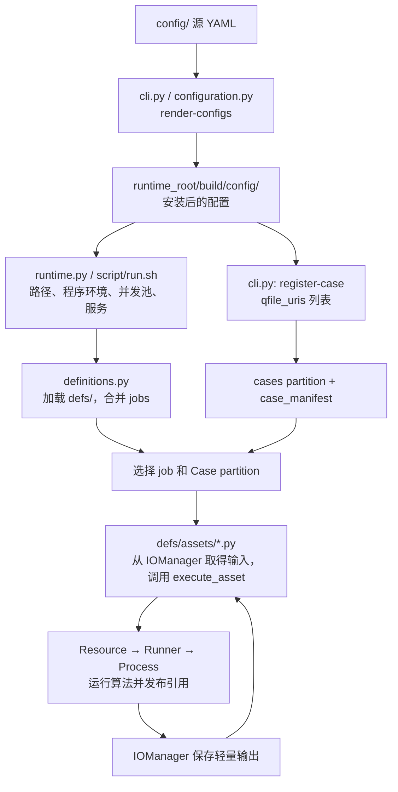
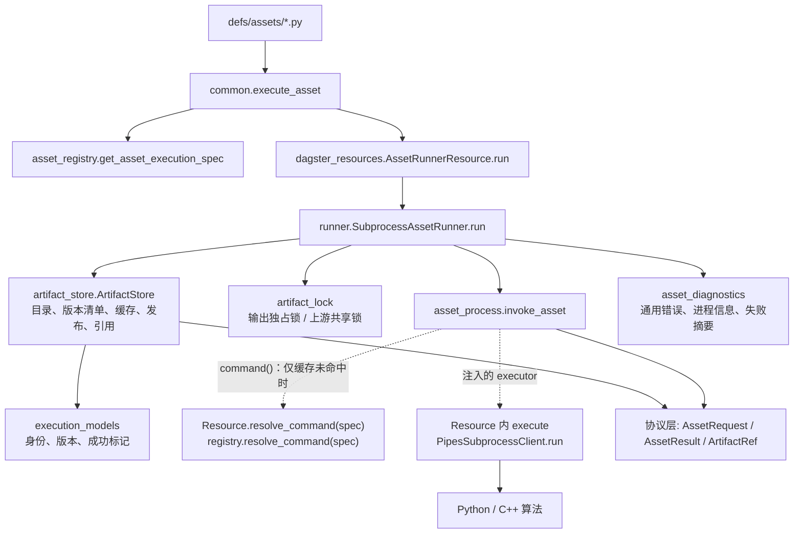

# Dagster 编排流程与模块关系

本目录把算法组织成按 Case 运行的资产图：Dagster 选择资产、安排依赖与并发，编排层准备请求、检查版本缓存、运行算法并发布产物。算法通过协议层的 JSON 协议读写输入和结果；PCD、图像和地图保存在 `payload/`，资产之间传递轻量引用。

## 总体流程



[configuration.py](configuration.py) 合成 Hydra 算法配置、展开插值并安装最终 YAML；[runtime.py](runtime.py) 读取安装后的 `dagster/runtime.yaml`，设置路径、运行环境和并发池。[cli.py](cli.py) 登记 qfile 与模型信息，将 Case ID 加入 [动态 partition](defs/partitions.py)，物化 `case_manifest`；登记不执行数据复制。

`config/dagster/` 包含 `runtime.yaml`、`cases.yaml` 和 `assets.yaml` 三份配置。
Case 登记统一读取 `cases.yaml`：`qfile_uris` 为非空列表，
可填写一个或多个本地路径或远端 URI。`register-case` 为列表中每个 qfile 建立独立 Case，
共用 YAML 中的模型引用；内部 `case_manifest` 保存该 Case 的单个 `qfile_uri`。

[definitions.py](definitions.py) 加载 `defs/` 并合并 [jobs.py](defs/jobs.py) 的资产选择规则。[resources.py](defs/resources.py) 注册 `io_manager`、`asset_runner`、`pipes_subprocess_client`。job 选择资产及其上游，运行时读取已登记的 `case_manifest`；它不重新定义算法执行步骤。

主要业务链为：

```text
case_manifest → qfile_snapshot → decoded_sensor_data → nuscenes_dataset
qfile_snapshot → GT PCD / vector 快照
case_manifest（模型本地路径）+ nuscenes_dataset + GT PCD/vector 快照 → 标定 → 定位
case_manifest + nuscenes_dataset → Scene 相机分割
NuScenes + 标定 + 定位 + mask → Case 栅格图 → Scene 裁剪
    → Scene 矢量占位 → Case 矢量占位 → 导出占位
    → 地图训练数据占位 + GT vector → 地图模型 checkpoint 占位
```

GT 标定、定位和地图训练由统一资产链声明输入；精修、训练和 asset checks 也在 `defs/assets/` 中定义。验证报告属于算法 payload，不设独立资产或配置。具体依赖以资产函数参数和 Dagster 资产图为准。

五个矢量生产与训练算法当前直接返回成功，不读取或校验业务输入，不生成业务文件，metrics、metadata 均为空。
编排保留现有依赖、协议解析、上游状态和发布检查。单个执行 payload 为空，`scene_vector_maps` 集合
仍由编排生成 `payload/index.json`；成功仅表示入口执行完成。缓存与强制重算规则保持不变。

| 定义位置 | 职责 |
| --- | --- |
| [common.py](defs/assets/common.py) | 统一分组；取得执行规格、构造请求、调用 Resource、记录执行 metadata、返回引用 |
| [ingestion.py](defs/assets/ingestion.py)、[ground_truth.py](defs/assets/ground_truth.py) | Case 登记、同步、解码、NuScenes 和 GT 快照 |
| [calib_localization.py](defs/assets/calib_localization.py) | 直接读取 manifest 模型路径、两种 GT 驱动的标定与定位 |
| [segmentation.py](defs/assets/segmentation.py)、[segmentation_training.py](defs/assets/segmentation_training.py) | 动态 Scene 分割、精修和训练 |
| [raster_map.py](defs/assets/raster_map.py) | 共用 Case 栅格地图与 Scene 裁剪 |
| [vector_map.py](defs/assets/vector_map.py)、[vector_map_training.py](defs/assets/vector_map_training.py) | 五个直接成功的矢量占位入口及原有依赖 |
| [validation.py](defs/assets/validation.py) | Scene 覆盖与最终 payload 的 Dagster asset checks |

## Python 调用关系



以 `decoded_sensor_data` 为例，资产函数把 `qfile_snapshot` 放进 `inputs={"qfile_snapshot": [ref]}`，调用 `common.execute_asset()`。common 从安装后的 `dagster/assets.yaml` 取得一次 `AssetExecutionSpec`，把数据版本、最终配置路径和输入写入 `AssetRequest`，传入 `command=lambda: asset_runner.resolve_command(spec)`。

执行规格恰好选择 Python `module` 或 native `executable`；程序路径直接写在资产登记中，
相对路径在加载时基于项目运行根目录转换为绝对路径，不通过环境变量查找。
解码算法内部使用的 `dataconvert` 在它自己的算法 YAML 中配置，由 `config_path` 传入。

Resource 接入 Dagster context、Pipes 和日志。Runner 获得锁并检查缓存；未命中时 Process 调用延迟命令函数，写 `_request.json`、追加 `--request/--result` 参数、启动算法并读 `_result.json`。Process 和 Store 分别在进程结果检查与最终发布时直接调用协议层的身份校验。成功后 Store 写标记，Runner 返回执行报告。

Resource 处理 Dagster 专用异常及 `dg.Failure`；Runner、Process、Store 和诊断模块组成可直接调用的执行核心，不导入 Dagster。直接调用 Runner 必须提供命令，可以注入测试执行函数，或由 Process 使用 `subprocess.run()`。Process 不查询 registry、不管理 Store；registry 从已有 spec 解析命令，不重复读取执行登记。

### AssetExecution 如何传给下游

```text
Runner.run() → AssetExecution(artifact, cache_hit, metrics)
    → Resource.run() 原样返回
    → common.execute_asset() 记录 metadata，返回 execution.artifact
    → 资产函数返回 dg.Output(ArtifactRef)
    → Dagster 将 Output.value 交给 IOManager.handle_output()
    → serialization 写入带类型的 JSON
    → 下游执行前 IOManager.load_input() 恢复 ArtifactRef
```

所有资产的业务输出统一为 `ArtifactRef`，包括 manifest、Scene 集合和模型 checkpoint。
[serialization.py](orchestration/serialization.py) 只恢复这一种引用及内部调度所需的基础 JSON 值，
受管 URI 按产物根保存为相对路径；模型配置由算法从 Case manifest 的 JSON 读取。
Resource 由 Dagster 注入，不经过 IOManager。

### Scene 动态展开

Case 是 partition；Scene 是运行时动态任务。[nuscenes.py](orchestration/nuscenes.py) 从 NuScenes 引用的 `metadata["scene_ids"]` 读取并校验 Scene，[dynamic_graph.py](orchestration/dynamic_graph.py) 为其生成稳定、合法的 mapping key。

分割和 Scene 裁剪采用 `emit → DynamicOutput → map → collect`，动态任务传递字符串 Scene ID。
每个 Scene 返回独立 `ArtifactRef`，有自己的目录、锁和缓存。
[publications.py](orchestration/publications.py) 在核验全部预期 Scene 及其成功状态后，生成集合
`payload/index.json`，返回 `scene_id=null` 的 `ArtifactRef`。集合的结果及成功标记包含子产物和祖先版本。
索引按 Scene ID 排序，子 URI 相对集合 payload，例如 `../scene-a/payload`。
集合重建只写自己的 payload 和状态文件，保留子 Scene 产物。
下游通过 `read_scene_collection` 读取引用并展开为算法的 `list[ArtifactRef]` 输入。

## 缓存规则

缓存只由显式数据版本管理。源 `config/dagster/assets.yaml` 登记 `data_version`，运行消费渲染后的文件；系统按请求身份定位目录，不寻找 latest。`ExecutionIdentity` 包含协议版本、分组、资产名、Case、Scene 和当前数据版本。

成功标记 `_SUCCESS.json` 只有两项：

- `identity`：当前 `ExecutionIdentity`。
- `upstream_versions`：去重、排序的扁平 `AssetVersion` 列表，每项保存资产名、分组、Case、Scene、数据版本；外部引用的 `group_name` 为 `null`。

Store 读取直接受管上游的成功标记，将上游自身版本与标记已有的版本清单合并；不读取祖先请求、算法 YAML 或原始 NAS。外部输入只记录引用身份和版本。比如 `A → B → C`，B 的标记保存 A 版本，C 保存 A、B 版本；A 升版后依次运行 B、C，即使 B、C 自身版本不变，也会重算并传播新清单。仅执行 C 时以已有 B 的清单为准，需更新上游时选择包含它们的 job。

命中要求当前身份和上游版本清单一致，成功标记与结果有效、结果身份匹配且成功、`payload/` 存在，并且没有 `_failure.json`。缺失或无效标记不命中；失败执行不可缓存。命中时不解析或启动算法命令，使用已有结果 metadata 构造引用。

**URI、配置、channel、源文件内容、metadata 和输入排列变化都不会自动失效。** 要发布新的数据语义，由负责人维护版本：

| 修改 | 需要更新的版本 |
| --- | --- |
| qfile 源内容或 `info.json` 地图记录 | `qfile_snapshot.data_version` |
| camera / LiDAR channel | `decoded_sensor_data.data_version` |
| 模型路径、内容或 manifest 内模型版本 | 消费资产的 `data_version`；重新登记本身不自动失效 |
| 其他算法参数、代码 | 对应生产资产的 `data_version` |

更新源版本与 YAML 后执行 `dagster-pipeline render-configs`，再运行受影响资产及其下游。`force_recompute` 只强制当前配置操作；同版本重算不改变版本清单，也不自动强制下游。需要临时重算整条链时显式选择并强制相关操作。

Runner 对输出持独占锁、对输入持共享锁，按统一路径顺序获取。直接上游和其扁平清单中的受管祖先按身份在当前产物根定位；取得锁后检查清单对应产物的标记、结果和 payload，不递归读取祖先 `_request.json`；外部引用不加入执行锁。执行发布前再次确认上游清单一致，成功后原子写标记，失败则清除成功状态并记录摘要。

复制完整产物及其引用目标后，当前产物根下的版本身份仍可复用；IO manifests 使用相对受管 URI，可重新生成。通用缓存检查不访问源 NAS 或算法配置路径；未命中而需要重新运行算法时，仍要求它的实际输入、程序和配置可用。
实际使用模型的算法只在执行时从 `case_manifest/payload/case.json` 读取模型路径并检查本地文件和必要格式，
不进行模型文件摘要校验，也不增加预检命令；缓存命中时不读取模型。纯 LiDAR 标定不要求相机模型文件。

缓存标记不替代算法业务校验。解码保留 `decode_manifest.json` 和通道产物检查；GT 下载保留包内 SHA256 和资源标签校验；模型检查本地路径、可读性及必要结构。这些校验由对应算法在执行时完成，公共协议保持独立。

## 文件、错误和模块职责

```text
<artifact_root>/<case>/<group>/<asset>/<data_version>/[scene]/
    _request.json       # 协议层请求
    _result.json        # 协议层结果
    _SUCCESS.json       # 编排成功标记
    _failure.json       # 编排失败摘要
    payload/            # ArtifactRef.uri 指向这里
<manifest_root>/<case>/<group>/<asset>.json
```

Process 同时检查算法状态和进程退出；算法失败保留原始结构化错误，启动/退出失败或缺失/无效结果生成编排错误。Pipes 专用异常由 Resource 转成通用进程信息；未确认的退出码保留为空。Runner 在输出锁内原子写失败摘要，Resource 转成带错误与文件路径 metadata 的 `dg.Failure(allow_retries=False)`。取消保留原始异常、清理成功状态，不伪装成算法失败。

`orchestration/` 的职责如下：

| 模块 | 职责与主要关联 |
| --- | --- |
| [dagster_resources.py](orchestration/dagster_resources.py) | Resource、Pipes 适配、JSON IOManager；接入 registry、Runner、serialization 和诊断 |
| [asset_registry.py](orchestration/asset_registry.py) | 加载执行 spec、解析命令；依赖 configuration 的安装配置路径 |
| [runner.py](orchestration/runner.py) | 锁、缓存分支、运行、发布和失败记录；调用 Store、Process、lock、diagnostics |
| [artifact_store.py](orchestration/artifact_store.py) | 目录、上游版本合并、缓存与引用、成功发布；使用 execution_models 和协议层 |
| [asset_process.py](orchestration/asset_process.py) | 执行明确命令、检查协议结果和进程状态；使用协议层和 diagnostics |
| [artifact_lock.py](orchestration/artifact_lock.py) | 基于 `fcntl.flock` 的共享/独占锁 |
| [execution_models.py](orchestration/execution_models.py) | ExecutionIdentity、AssetVersion、SuccessMarker、进程与失败模型；使用 json_io |
| [asset_diagnostics.py](orchestration/asset_diagnostics.py) | 通用执行异常、进程信息和失败摘要；使用 execution_models |
| [serialization.py](orchestration/serialization.py) | 统一引用编码/恢复、受管 URI 相对化；使用 json_io、协议层 |
| [json_io.py](orchestration/json_io.py) | 严格 JSON 校验及原子写入 |
| [publications.py](orchestration/publications.py) | 发布真实 Case manifest 和 Scene 索引，校验集合完整性及子产物成功状态 |
| [artifact_resolver.py](orchestration/artifact_resolver.py) | 为资产检查解析本地产物路径 |
| [nuscenes.py](orchestration/nuscenes.py) | 从 metadata 读取并验证 Scene 字符串 ID |
| [dynamic_graph.py](orchestration/dynamic_graph.py) | 为 Scene 生成动态 mapping key |
| [__init__.py](orchestration/__init__.py) | 包入口，当前无业务逻辑 |

[协议层](../protocol/README.md) 只负责公共请求、结果、错误和产物引用协议；缓存、锁、成功/失败标记、IO 和进程诊断属于编排。算法使用协议层，不需要导入 Dagster 或 Pipes。

## 操作与排查

以下命令在仓库根执行，使用已安装的环境；修改源配置后显式渲染：

```bash
uv run dagster-pipeline render-configs
uv run dagster-pipeline register-case \
    --config build/config/dagster/cases.yaml
uv run dagster-pipeline runtime-env
uv run dg list defs --json
uv run dg check defs
```

首次安装和服务启动使用 `./script/install.sh`、`./script/run.sh`。UI 选择 job 和已登记 Case partition；例如 `module_ingest_job` 运行同步、解码与 NuScenes。

依赖或 job 范围看 `defs/`；程序入口和版本看 registry 与安装后的 `assets.yaml`；缓存与并发看 Runner/Store/lock；执行错误看 Process/diagnostics/Resource；下游对象类型看 IOManager/serialization。算法参数和业务格式另见[配置说明](../../docs/configuration.md)、[算法接口](../../docs/algorithm-contract.md)及各算法 README。
