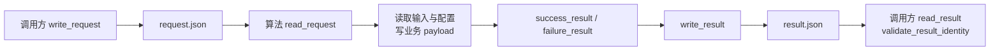

# 公共 JSON 协议与生成代码

协议以 `schema/asset_protocol.v1.schema.json`（JSON Schema Draft 7）为唯一字段定义。
Python dataclass 和 C++17 struct 由固定的 quicktype 26.0.0 生成。
Python 使用 jsonschema 4.x；C++ 使用 nlohmann-json ≥ 3.11.2 和 Valijson ≥ 1.0。
项目安装脚本优先使用 apt 包，仓库缺包或版本过旧时将校验过的固定源码安装到 `.deps/json/`。
协议层提供请求、结果、产物引用和错误的类型及读写接口。算法通过这些接口取得公共字段，
再解析自己的配置和业务文件；进程状态、缓存和编排诊断由调用方管理。

## 一次调用如何传递输入与输出



算法入口统一使用 `--request <请求文件> --result <结果文件>`。`inputs` 中每个引用的 `uri`
指向上游 payload，`config_path` 指向算法 YAML，`output_uri` 指向本次输出 payload。
公共解析只校验这些字段的形状和字符串，不打开引用目录、不读取 YAML，也不加载模型。
路径解析、文件检查和业务内容读取由算法负责；独立运行时也需要算法创建并写入自己的 payload。

`AssetResult` 报告状态、错误、指标和元数据，不包含输出 `uri` 或 `outputs` 列表。
在本项目中，Dagster 根据请求身份和受管目录生成最终 `ArtifactRef`，将结果 metadata 带入引用，
检查结果及上游状态后发布成功标记。`write_result()` 只写协议结果文件。

代码生成发生在开发阶段。运行时的读取顺序为：严格 JSON 解析 → Schema 与输入引用关系校验 →
补齐可省略字段的默认值 → 转换为生成的 dataclass/struct。写入时先校验模型，再序列化并原子写入。
生成代码保存字段与嵌套类型，C++ 另生成基础 JSON 转换，公共读写封装提供完整校验；
算法从公共包或头文件接入。

| 内容 | 来源与职责 |
| --- | --- |
| `schema/asset_protocol.v1.schema.json` | 人工维护的公共字段与约束规范 |
| `python/asset_protocol/generated.py`、`cpp/asset_protocol/include/asset_protocol/generated.hpp` | 自动生成的双语言模型 |
| `python/asset_protocol/schema.json`、`cpp/asset_protocol/src/schema.inc` | 自动生成的运行时 Schema 副本 |
| Python `helpers.py` / `validation.py`、C++ `protocol.cpp` | 通用读写、Schema 校验和少量跨字段关系检查 |

## 请求 JSON 与字段

将以下内容保存为 `request.json`。其中路径是演示值，协议层不会要求对应业务文件存在。

```json
{
  "protocol_version": "v1.0",
  "asset_name": "example_asset",
  "case_id": "case-001",
  "data_version": "v1.0",
  "scene_id": null,
  "config_path": "/tmp/asset-protocol-demo/config.yaml",
  "output_uri": "/tmp/asset-protocol-demo/payload",
  "inputs": {
    "nuscenes_dataset": [
      {
        "asset_name": "nuscenes_dataset",
        "uri": "/tmp/asset-protocol-demo/dataset/payload",
        "data_version": "v1.0",
        "case_id": "case-001"
      }
    ],
    "scene_raster_maps": [
      {
        "asset_name": "scene_raster_maps",
        "uri": "/tmp/asset-protocol-demo/scene-a/payload",
        "data_version": "v1.0",
        "case_id": "case-001",
        "scene_id": "scene-a"
      },
      {
        "asset_name": "scene_raster_maps",
        "uri": "/tmp/asset-protocol-demo/scene-b/payload",
        "data_version": "v1.0",
        "case_id": "case-001",
        "scene_id": "scene-b"
      }
    ]
  }
}
```

身份必填字段为 `protocol_version`、`asset_name`、`case_id`、`data_version`。
它们分别表示协议版本、当前执行资产、Case 和当前资产数据版本；`protocol_version` 必须为 `v1.0`。
输入引用保留生产者自己的版本，不要求等于本次输出版本。

| 模型 | JSON 必填字段 | 可省略字段与默认值 |
| --- | --- | --- |
| `AssetIdentity` | 身份必填字段 | `scene_id=null` |
| `AssetRequest` | 身份必填字段、`output_uri`、`config_path`、`inputs` | `scene_id=null` |
| `ArtifactRef` | `asset_name`、`uri`、`data_version`、`case_id` | `scene_id=null`、`metadata={}` |
| `AssetResult` | 身份必填字段、`status`、`error` | `scene_id=null`、`metrics={}`、`metadata={}` |
| `AssetError` | `category`、`code`、`message` | `details={}` |

生成模型的构造默认值与 JSON 必填要求不同：虽然构造对象时 `protocol_version` 和 `inputs`
有默认值，原始请求 JSON 中仍必须显式填写；先校验必填字段，再补可选默认值。
`write_request()` 会把构造默认值写入 JSON。可省略也不表示允许 `null`，例如 `metadata:null` 非法。
`ArtifactRef` 不含 `protocol_version`。

## Python：读取输入与写入结果

```python
from asset_protocol import (
    input_ref, input_refs, read_request, success_result, write_result,
)

request = read_request("request.json")
dataset = input_ref(request, "nuscenes_dataset")
scenes = input_refs(request, "scene_raster_maps")
print(dataset.uri, request.config_path, request.output_uri)
for scene in scenes:
    print(scene.scene_id, scene.uri)

# 算法在这里加载配置、读取输入 payload，并将业务产物写入 request.output_uri。
result = success_result(request, metrics={"scene_count": len(scenes)})
write_result("result.json", result)
```

`request.inputs` 已转换为 `dict[str, list[ArtifactRef]]`，嵌套引用可直接通过属性访问。
多 Scene 资产在编排侧先展开集合索引，再把子引用作为列表传给算法；协议保留列表顺序。
`scene_id=null` 的集合引用本身仍是普通 `ArtifactRef`，集合 `index.json` 的内容属于编排业务格式。

模型是普通生成 dataclass，没有实例 `read/write/from_dict/to_dict/validate` 方法。
使用 `from_dict(AssetRequest, payload)`、`to_dict(model)`、`validate(model)`。
构造对象时不自动校验；转换、读写、结果工厂和引用访问入口会校验。

## C++：读取输入与写入结果

```cmake
add_subdirectory(path/to/cpp/asset_protocol asset_protocol)
target_link_libraries(your_algorithm PRIVATE asset_protocol::asset_protocol)
```

```cpp
#include <asset_protocol/protocol.hpp>

int main() {
  const auto request = asset_protocol::read_request("request.json");
  const auto& dataset = asset_protocol::input_ref(request, "nuscenes_dataset");
  const auto& scenes = asset_protocol::input_refs(request, "scene_raster_maps");
  // dataset.uri 是输入 payload；request.config_path、output_uri 由算法解释并处理。
  static_cast<void>(dataset);
  auto result = asset_protocol::success_result(request, {{"scene_count", scenes.size()}});
  asset_protocol::write_result("result.json", result);
}
```

C++ 模型为字段平铺的值类型。
`asset_protocol::Json` 就是 `nlohmann::json`；metadata、metrics、details 为
`std::map<std::string, Json>`，Python 对应 `dict[str, Any]`，可以直接读写业务键。
`from_dict<T>(json)`、`to_dict(model)`、`validate(model)` 为通用校验转换入口。
文件写入函数均按 `write_request(path, request)` / `write_result(path, result)` 排列参数。

两种语言的输入访问函数使用相同规则：

| 函数 | 行为 |
| --- | --- |
| `input_refs(request, name)` | 要求 key 存在，允许空列表；Python 返回 tuple，C++ 返回 vector 的常量引用 |
| `input_ref(request, name)` | 要求该 key 恰好有一个引用 |
| `input_key(request, ...)` | 要求候选名称中恰好一个 key 存在；不检查引用数量 |

Python 的候选名写作 `input_key(request, "producer_a", "producer_b")`，C++ 写作
`input_key(request, {"producer_a", "producer_b"})`。这些函数都会重新校验请求。
公共协议要求每个输入 key 等于列表中引用的 `asset_name`，但不限制具体资产名、Case/Scene 关系
或输入数量。每个算法需要哪些输入、是否允许跨 Case、业务文件是否可读，由算法或编排判断。

## 成功、失败与调用方读取结果

上面两种语言写出的成功结果等价于：

```json
{
  "protocol_version": "v1.0",
  "asset_name": "example_asset",
  "case_id": "case-001",
  "data_version": "v1.0",
  "scene_id": null,
  "status": "success",
  "error": null,
  "metrics": {"scene_count": 2},
  "metadata": {}
}
```

失败时使用 `failure_result`，由工厂复制身份并校验结果。Python 示例：

```python
from asset_protocol import AssetError, failure_result, read_request, write_result

request = read_request("request.json")
error = AssetError("input", "INPUT_MISSING", "缺少输入文件", {"path": "/tmp/missing.pcd"})
write_result("failed-result.json", failure_result(request, error))
```

C++ 对应调用为 `failure_result(request, AssetError{"input", "INPUT_MISSING", "缺少输入文件"})`。
成功必须显式包含 `error:null`；失败必须包含合法错误对象。`AssetError.category` 只允许
`input`、`resource`、`algorithm`、`process`、`protocol`，`code`、`message` 必须为非空白字符串。
`write_result()` 不决定进程退出码；算法入口应在失败时返回非零，并由调用方同时检查退出状态和结果。

`read_result()` 校验结果自身，调用方还要显式核对请求身份，并依据 `status` 处理成功或失败：

```python
from asset_protocol import read_request, read_result, validate_result_identity

request = read_request("request.json")
result = read_result("result.json")
validate_result_identity(request, result)
if result.status == "failed":
    raise RuntimeError(f"{result.error.code}: {result.error.message}")
```

C++ 对应使用 `read_result(path)` 和 `validate_result_identity(request, result)`。
核对字段为 `protocol_version`、`asset_name`、`case_id`、`data_version`、归一化后的 `scene_id`；
结果文件本身合法，不代表它属于本次请求。

### 请求解析失败时如何报告

先调用 `read_request_identity(path)` 保存可信身份，再在异常处理内读取完整请求、执行算法。
当配置字段缺失或输入形状错误，但 JSON 和身份合法时，可以通过
`failure_result(identity, error)` 写出同身份失败结果。
身份读取仍严格解析整份 JSON：JSON 损坏、重复键、非法 Unicode、整数溢出或身份无效时会失败，
此时入口通过 stderr 和非零退出报告，不能自行编造身份。完整入口见
[Python 示例](examples/python/algorithm.py)与 [C++ 示例](examples/cpp/main.cpp)。

异常分类由执行封装决定：仓库算法封装将可恢复的请求校验错误报告为 `protocol/REQUEST_INVALID`，
业务异常报告为 `algorithm/ALGORITHM_EXCEPTION` 或算法自定义错误；独立最小示例使用 `EXAMPLE_FAILURE`。

## 公共读写接口与校验边界

| 操作 | Python | C++ |
| --- | --- | --- |
| 文件 → 模型 | `read_request(path)` / `read_result(path)` | 同名函数 |
| 内存 JSON → 模型 | `from_dict(AssetRequest, value)` | `from_dict<AssetRequest>(value)` |
| 模型 → 内存 JSON | `to_dict(model)` | `to_dict(model)` |
| 检查内存模型 | `validate(model)` | `validate(model)` |
| 模型 → 文件 | `write_request(path, model)` / `write_result(path, model)` | 同名函数 |

原始 JSON 文本应通过文件读取入口，或 Python 的 `asset_protocol.io.decode_json(text)` 加
`from_dict(...)`；C++ 也提供 `parse_request(text)` / `parse_result(text)`。
普通 JSON 解析可能已丢失重复键等原始文本信息，部分解析器还会将超范围整数转换为浮点数，
之后调用 `from_dict()` 无法恢复这些信息。直接调用生成模块的转换函数也会绕过完整协议校验。

`write_request`、`write_result` 先校验，再创建父目录，通过同目录临时文件、fsync 和原子替换保存。
它们不会为算法发布 Dagster 的 `_SUCCESS.json` 或 `_failure.json`。

模型对象拒绝未知字段；metadata、metrics、details 是开放的 JSON 对象，允许任意嵌套 JSON。
JSON 必须为严格 UTF-8、单文档、无重复键、对象键无 NUL、Unicode 标量合法、数字有限。
整数字面量支持 `INT64_MIN..UINT64_MAX`，超出范围会在转换为协议模型前拒绝；
C++ 在构建可能丢失整数精度的 JSON DOM 前检查原始 token，Python 保留精确整数后检查范围。
带小数点或指数的数字按有限 IEEE-754 double 处理。大整数作为 JSON 数字写出。
通用校验并不依赖 quicktype 的 Python `assert`，在 `python -O` 下同样生效。
非空白字符串使用共享的 `format: non-blank`：Python FormatChecker 和 C++ Valijson
约束使用相同的 Unicode 空白定义，避免依赖 C++ 字节正则处理 Unicode。
字符串值允许 NUL，包括仅包含 NUL 的非空白字符串。Valijson 1.0 的原生长度约束会在
NUL 处截断，因此生成器拒绝模型中的 `minLength` / `maxLength`，直到加入精确的 Unicode
长度校验；非空白要求使用 `format: non-blank`。
`pattern` 也暂不属于生成 profile：Python 与 C++ 正则引擎的 Unicode 语义不同，
生成器会拒绝此约束，直到加入共享实现。对象键的 NUL 限制由严格 JSON 边界检查。

公开 typed `integer` 字段由 quicktype 生成为 C++ `int64_t`；它不会依据 maximum 自动
生成 `uint64_t`。如要新增超出 `INT64_MAX` 的 typed 字段，需要先扩展生成类型策略，
不能直接把它声明为普通 integer。Valijson 1.0 的数值边界内部使用 double；生成器会拒绝
未显式声明 minimum/maximum 或边界绝对值大于等于 `2**53` 的 typed integer 字段，
直到加入精确边界验证策略；nullable integer 也使用相同生成规则。
typed integer 仅接受 JSON 整数字面量，`1.0` 和 `1e0` 即使数值为整数也会被双端拒绝。
开放 metadata 内的 uint64 不受此限制。
请求 input key 与 ArtifactRef.asset_name 对应、request/result 身份一致为少量关系校验；
普通字段变化不需要在两种语言重写这些检查。
公共模型字段使用 snake_case，并避开 Python/C++ 关键字，使 JSON 字段名与双端成员名
保持一致；camelCase 等不能直接映射的名字会在生成阶段明确报错。开放 metadata 内的
业务键不受此命名规则限制。

## 修改 Schema 与重新生成

修改公共字段后，在本仓库根目录执行：

```sh
npm ci --prefix src/protocol/codegen
uv run python script/generate_protocol.py
uv run python script/generate_protocol.py --check
```

Node ≥ 20 只在生成时使用。提交 Schema 和生成文件，不手改 `generated.py`、
`generated.hpp`、`schema.inc` 或 Python 包中的 `schema.json`。
默认值也写在 Schema 中；生成器为模型添加构造默认值，公共读入入口恢复可省略字段的默认值。
普通可选字段、嵌套模型与容器变化不需要手写双端逐字段解析；算法按新字段的业务含义调整使用逻辑。
生成器取 Schema 的类型结构，枚举和 const 对外使用普通字符串，由完整 Schema 校验。

## 独立导出、运行与验证

在仓库执行 `uv run dagster-pipeline export-asset-protocol --output-directory /path/to/protocol`，或调用
`asset_protocol.export.export_asset_protocol(path)`。输出源码目录和 `.tar.gz`：

```sh
python -m pip install /path/to/protocol/python
cmake -S /path/to/protocol/examples/cpp -B /tmp/protocol-example
cmake --build /tmp/protocol-example
python /path/to/protocol/examples/python/algorithm.py --request request.json --result python-result.json
/tmp/protocol-example/asset-protocol-example --request request.json --result cpp-result.json
```

独立协议包运行或编译无需 quicktype/Node，也不依赖本仓库的算法或 Dagster 包。
`examples/python/algorithm.py` 与 C++ 示例都支持 `--request`、`--result`、`--fail`。
追加 `--fail` 可验证结构化失败结果和非零退出；最小示例只读写协议文件，业务 payload 由实际算法生成。
Python/C++ 使用同一份 `fixtures/contract.json` 检查合法/非法模型及 JSON 边界。

```sh
uv run pytest tests/test_asset_protocol.py tests/test_protocol_schema.py tests/test_protocol_export.py
cmake -S src/protocol/cpp/asset_protocol -B /tmp/protocol-build -DASSET_PROTOCOL_BUILD_TESTS=ON
cmake --build /tmp/protocol-build
ctest --test-dir /tmp/protocol-build --output-on-failure
```

导出测试还会在临时副本中只增加可选字符串及有界整数 request 字段，重新生成双端 SDK，
编译 C++，跨语言读写这些字段，并确认 Python/C++ 通用校验封装未变化。
重复生成会保留内容未变文件的修改时间，避免触发无关 native 重编译。
